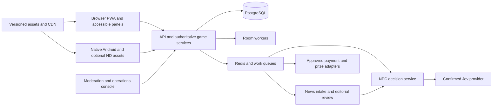

# Naija Street Life — build proposal

Phase 3 draft · 12 October 2026 · Awaiting approval before implementation

## Recommendation

Build a stylized 3D Nigerian life game with **one account and shared progress across browsers and a native Android app**. Use **Godot with GDScript**, a TypeScript backend, PostgreSQL, and an original Blender asset pipeline, subject to a short export/performance evaluation after approval.

Browsers receive a compact, broadly compatible presentation. Android receives an engine-native AAB with optional higher-detail assets, lighting and crowd presentation on capable devices. Both connect to the same authoritative game services. Graphics quality must never change earnings, voting power, mission eligibility or prize chances.

The release should be staged: a complete small life-simulation first, followed by controlled real-work and airtime/data pilots. This document covers all eight required features; it does not claim the regulated/live-service features are already approved or available.

**Planning assumptions awaiting your confirmation:** both fictional gigs and real paid work are eventual goals; initial audience is adults 18+; Lagos is the first setting; TypeSafe's Jev is the likely AI product; Google Play is the first Android distribution channel. No accounts, API keys, purchases or implementation have been created for this proposal.

## Concept and differentiation

**Pitch:** “Build your life, earn your reputation, and shape your street.”

Your character starts with a modest home and chooses how to spend the day: learn a trade, cook, commute, help neighbors, take gigs, meet people and influence a fictional neighborhood council. Success is visible in skills, relationships, living space and community improvements.

Differentiate through:

- **Useful work and trustworthy services:** clear deliverables, professional profiles, completed-job reviews and disputes, rather than an unstructured board of solicitations.
- **NPCs with continuity:** stable personalities, goals, remembered relationships and decisions tied to what happened in the world.
- **A living Nigerian setting:** weather, power, transport, food, trades, rent pressures and community life that affect choices. Validate with local players rather than treating slang and famous venues as sufficient authenticity.
- **Reliable progression:** check every quest branch against resources, access, time and skills; provide alternate routes. Generate daily goals that the player can actually attempt.
- **Scalable presentation:** readable controls and low-data play in browsers, plus optional higher graphics in Android.
- **Real-world connections with clear boundaries:** separate paid work, sponsor-funded prizes and sourced news from fictional currency and politics.

All assets, characters, quests, dialogue, UI and audio will be original or licensed. The Lagos Life research informs design choices, not implementation copying. Validate the name/domain/trademark position before public branding or spending.

## The play loop

**First five minutes:** choose an avatar and a starting interest, enter a small home, meet a fictional neighbor, recover one need, finish a short paid-in-coins starter task, then personalize the home. Offer an immediately playable guest/local tutorial; explain cloud accounts before saving online. No real payment or identity document is required to learn the game.

**Normal session, 10–20 minutes:** check needs and current goals → choose a job/activity/trip → complete a skill or social interaction → earn/reinvest → encounter a story → see a clear next objective.

**Return session:** show a recap of approved offline changes, claimed rewards, unfinished work and tomorrow's opportunities. Use streak grace and flexible goal swaps; avoid punishing players for losing connectivity or missing a day.

Needs: food, energy, cleanliness, comfort and connection. Skills: cooking, repair, digital work, design, trade, driving, communication and creativity. Distinguish game skill levels from verified professional credentials. Characters keep stable traits and relationship memories; expensive possessions do not unlock all meaningful stories.

World simulation uses a configurable game-time cycle. Display opening windows clearly and provide alternatives when a venue is closed. Community schedules and real promotion deadlines use explicit Africa/Lagos times. Offline catch-up is bounded and calculated by the server, never by trusting the device clock.

## Scope: playable alpha versus full release

| Required feature | First playable alpha | Controlled beta / full release |
|---|---|---|
| 1. Job/gig marketplace | Paid posting in StreetCoins; applications, categories, search, service listings, virtual holds, deliverables, reviews and disputes. | Real paid work with employer posting fees, approved collection/holding/payout arrangements and verified providers. |
| 2. Profiles and skills | Bio, game skill history, portfolio links/uploads with moderation, privacy controls and game gig matching. | Professional experience, credential verification where useful, transaction-based service reputation. |
| 3. Graphics settings | Low/Medium/High, shadows/effects/distance/FPS, separate Data Saver, automatic recommendation; browser and Android export. | Optional Android HD pack and tuned native rendering after device profiling. |
| 4. Polls and elections | Fictional council election, ordinary community polls, transparent rules, candidate policies and visible world consequences. | More offices, campaign tooling and stronger reviewed anti-abuse controls. |
| 5. Data/airtime games | Free practice mini-games and end-to-end sandbox prize fulfillment. No real reward promises yet. | Funded, approved free-entry skill-reward pilot; then capped recurring events. |
| 6. Jev NPC decisions | Real Jev adapter after vendor confirmation; selected action/dialogue intents; deterministic outage fallback. | Larger roster, more event responses and better memory/consistency evaluations. |
| 7. News service | Approved-source adapter, provenance, caching/deduplication and review workflow; live feed only under suitable rights. | Licensed production feed and approved official/local sources, with coverage monitoring. |
| 8. News-linked NPC conversations | Jev selects responses from reviewed news fact cards and authored personality templates; disable/review controls. | Optional separate text-generation service only if needed and separately evaluated. |

**Alpha content cap:** one compact mainland neighborhood inspired by Yaba/Surulere, eight venue/interior types, one home, four career families, 24 named NPCs, eight original branching stories and two original skill mini-games. Use small instanced shared spaces, initially approximately 12–20 players per room, not a city containing every player at once.

**Later:** additional Lagos districts, Abuja/Port Harcourt, expanded housing/business ownership, family systems, more transport, richer events and additional mini-games. Defer unrestricted user-generated building, voice chat, real-money staking and a giant seamless city. Do not advertise all required features as complete while real services are only sandboxed.

## Stack options and decision

| Option | Browser and Android approach | Trade-offs |
|---|---|---|
| **A — Godot + GDScript, recommended** | Browser WebAssembly/WebGL2 export; native Android engine build; Kotlin plugins for platform functions. Same scene/content project, separate renderer profiles. | Strong game-authoring workflow and MIT license. Browser engine payload and rendering/audio limitations need early measurement; shaders/assets need testing across renderers. |
| **B — Unity + URP** | Unity Web build and native Android build, sharing game logic/assets with quality tiers. | Established mobile production tooling; engine/bootstrap size and project complexity need testing. Review current commercial licensing and platform/plugin costs before choosing. |
| **C — Babylon.js + TypeScript + Babylon Native/React Native** | Web client with web rendering; native Android graphics through Babylon React Native. | Strong web UI/code reuse potential; more native integration and feature-parity work. Native repository documents input/view limitations and JS-heavy performance concerns. |

Godot's current web documentation requires WebAssembly/WebGL2, uses Compatibility rendering and does not support Godot 4 C# web export. Start with single-threaded web export and optimize its template/payload. Native Android is a distinct export. [Godot web export](https://docs.godotengine.org/en/stable/tutorials/export/exporting_for_web.html), [Android export](https://docs.godotengine.org/en/stable/tutorials/export/exporting_for_android.html), [license](https://godotengine.org/license/).

Godot's Mobile renderer targets newer mobile hardware; Compatibility covers the browser and lower-end hardware. Advanced desktop-only effects must not become promises for Android High. [Renderer feature matrix](https://docs.godotengine.org/en/stable/tutorials/rendering/renderers.html).

Unity's current documentation lists supported mobile web browsers; do not rule it out using older claims of no mobile-web support. [Unity web compatibility](https://docs.unity.com/en-us/engine/6000.5/manual/platform-specific/webgl/intro/browsercompatibility). The third option uses a native rendering bridge, whose limitations need a spike. [Babylon React Native](https://github.com/BabylonJS/BabylonReactNative).

**Decision gate:** after approval, export the same benchmark street/home scene to browser and Android. Select Godot only if cold/warm startup, frame stability, accessibility integration and device coverage meet the agreed limits. If the browser payload fails after optimization, evaluate option C; if production tooling/graphics needs dominate, evaluate option B. Freeze exact engine/plugin versions after this test.

## Shared backend and saves

Start with a modular service, not a collection of premature microservices:

| Component | Proposed responsibility |
|---|---|
| TypeScript + Fastify | HTTPS APIs, shared schemas and business modules. |
| Authoritative room workers / WebSockets | Presence, player intent, state deltas and validated room activities. |
| PostgreSQL | Accounts, profiles, inventory, virtual ledger, jobs, contracts, reviews, elections, prize records and audit trails. |
| Redis + background workers | Short-lived cache, queues, rate limits, locks, notifications and NPC/news jobs; never the sole record of financial or ballot state. |
| Object storage + CDN | Versioned original asset packs and reviewed portfolio/media uploads. |
| React web shell / admin | Accessible text-heavy marketplace, account and moderation flows. Android uses native accessible panels/bridges where required; test TalkBack rather than assume canvas accessibility. |
| Platform integrations | Android keystore, opt-in notifications, billing, Integrity and asset delivery; browser session cookies and versioned PWA caching. |

Clients send intent; servers decide eligibility, inventory, money, rewards, ballots and successful task completion. The renderers consume shared content schemas; server rules remain authoritative even where client preview logic exists in GDScript. Use versioned snapshots, ordered event/revision IDs, idempotency keys and reconciliation to prevent duplicate claims across devices.

Allow one active transaction/competitive action per account where needed. A reconnect resumes current state; a second device must not replay earnings. Keep durable histories and backup/restore drills. Separate privileged admin roles; log money, moderation, configuration and policy changes.

Offline: cached tutorial/home customization/practice may work; record cosmetic drafts for later reconciliation. Marketplace payments, purchases, votes, real prizes and certified competitive results require a server connection. Show network state and pending/confirmed status clearly. PWA caching is a delivery mechanism, not proof of safe offline transactions.

## Browser and native Android graphics

Use one art direction: expressive stylized characters, recognizable Nigerian street details, readable color/material groups and believable lighting. Higher quality should improve detail and animation, not replace the game with a different visual identity.

**Initial targets, to be validated rather than promised:**

| Tier | Presentation | Approximate scene budget | Platform |
|---|---|---|---|
| Low | 30 FPS target, reduced resolution, 512px atlases, baked/blob shadows, reduced effects, short distance and few ambient characters. | ≤100 draw calls, ≤100k visible triangles. | Low-end browser/Android. |
| Medium | 30 FPS target, 1024px atlases, one bounded shadow light, more animation/detail and medium distance. | ≤180 draw calls, ≤250k visible triangles. | Supported browsers and mid-range Android. |
| High | 60 FPS where sustained, otherwise 30; 2048px hero textures, better shadows/materials, more visual crowd density and longer distance. | ≤300 draw calls, ≤600k visible triangles. | Capable desktop browser and Android, subject to renderer support. |
| Android Enhanced | High plus optional HD assets, richer Mobile-renderer lighting/reflection probes, materials and animation polish within device limits. | Profile individually; no gameplay changes. | Eligible native Android devices. |

Expose Low/Medium/High, shadow quality, effects, view distance, resolution scale, 30/60 FPS cap and separate Data Saver. Unsupported options are disabled with a plain explanation. Do not promise volumetric fog, screen-space reflections or desktop-grade GI for the recommended Mobile renderer.

Auto recommendation combines capability checks and a short first-run benchmark. Memory/device labels alone are not sufficient. Android watches thermal/frame behavior and suggests a downgrade; browser uses measured frame/load behavior and available coarse signals. Store the user's preference and provide manual override. Renderer changes that require restart must say so.

**HD delivery:** show estimated bytes before download, offer Wi-Fi-only/resume/cancel/delete controls and fallback to base assets if space/network is insufficient. Google Play Asset Delivery supports on-demand assets and texture targeting; the Godot/Kotlin integration still needs validation. [Android asset delivery](https://developer.android.com/guide/playcore/asset-delivery), [texture targeting](https://developer.android.com/guide/playcore/asset-delivery/texture-compression).

Data Saver reduces downloads, texture/audio tiers, automatic media, prefetch and remote-avatar update frequency; it does not hide essential gameplay. Send nearby state in compact deltas and interpolate presentation locally. Use the same NPC economy and actual room population on all tiers; only cosmetic crowds/detail vary.

Suggested validation targets:

- Browser lightweight account/marketplace shell ≤600 KB compressed before optional media.
- First playable 3D download ≤15 MB compressed; reject sustained >20 MB for the minimum experience unless an agreed lightweight alternative is provided.
- At 8 Mbps, target cold 3D entry ≤25 seconds; at 2 Mbps expect a longer first download, approximately 60–75 seconds for 15 MB plus startup. Always show progress and allow useful text/map interaction while waiting.
- Warm start ≤8 seconds; routine gameplay traffic ≤10 MB/hour excluding assets and optional media, to be measured with realistic room activity.
- Android base download target 60–100 MB; optional HD pack approximately 150–300 MB. These are budgets to test, not measured build sizes.
- Test 3 GB entry-class, 6 GB mid-range and capable 8 GB devices, plus supported Chrome/Firefox/Edge/Safari browsers. Run at least 20-minute heat/memory tests. No claim that RAM alone guarantees High.

## Blender pipeline and first assets

Keep editable `.blend` masters and canonical glTF 2.0/GLB exports. Use meters, consistent origins/transforms, clean UVs, a common humanoid rig, simple collision meshes and named animation clips. Import/build into engine resources for distribution; avoid parsing every source GLB during gameplay. Godot supports glTF import workflows. [Available formats](https://docs.godotengine.org/en/stable/tutorials/assets_pipeline/importing_3d_scenes/available_formats.html), [import configuration](https://docs.godotengine.org/en/stable/tutorials/assets_pipeline/importing_3d_scenes/import_configuration.html).

Budgets: character LOD0 8–12k triangles, LOD1 3–5k, LOD2 1–2k; vehicles 8–15k/3–6k/1–2k; modular building chunks 2–8k; props generally 100–1,500. Use 512/1024 shared atlases with 2048 hero sheets only in eligible tiers; normally one or two materials per object. Limit transparency and unique materials. Bake lighting where practical; instance repeated structures and props.

**Compression:** evaluate Draco geometry compression with measured file savings and decoding time, but do not assume a chosen Godot importer/runtime supports every glTF extension. Verify the exact importer during the export spike. If unsupported, decode during the asset build and distribute optimized engine resources with pack/HTTP compression. Geometry compression does not remove the runtime polygon cost. Use engine-supported GPU texture compression, browser-compatible variants, and ASTC/ETC2 Android variants where supported. Test quality and memory, not just file size.

Names: `nsl_chr_citizen_a_lod0`, `nsl_env_shopfront_01`, `nsl_veh_minibus_01_lod1`, `nsl_mat_fabric_adire_01`; suffix collision helpers and animation clips consistently. Each asset gets an ID, version, provenance/license, LOD/material/texture budgets and tier/pack assignment.

| # | First asset to model | Purpose |
|---|---|---|
| 1 | Original base citizen rig/body | Shared animation foundation. |
| 2 | Modular casual clothing set | Player/NPC variety. |
| 3 | Original agbada/kaftan clothing set | Cultural silhouette. |
| 4 | Original wrapper/blouse clothing set | Cultural silhouette. |
| 5 | Hair/accessory kit | Braids, locs, cuts and visual identity. |
| 6 | Modular starter-room walls/floor/doors | Home and interiors. |
| 7 | Modest bed | Rest activity. |
| 8 | Chair/stool/sofa kit | Home and social seating. |
| 9 | Cooker/pot/prep counter | Cooking activity. |
| 10 | Water tank/tap/bucket kit | Water/cleanliness interactions. |
| 11 | Generator/inverter kit | Power-management choices. |
| 12 | Modular street/sidewalk/drain kit | Neighborhood layout. |
| 13 | Modular shopfront/shutter kit | Reusable local businesses. |
| 14 | Food stall/tableware kit | Food career and social venue. |
| 15 | Provision stall/crate/goods kit | Trade/inventory setting. |
| 16 | Barber/salon chair/mirror kit | Service venue. |
| 17 | Shared minibus exterior/interior | Original transport art. |
| 18 | Keke | Local transport. |
| 19 | Repair bench/tools/laptop kit | Repair/digital careers. |
| 20 | Community-square notice/voting kiosk | Polls, events and council. |

Build low/medium/native-HD packs from those masters, with manifest hashes, material fallbacks, LOD transitions and controlled unloading. Load the current block/interior first; stream adjacent blocks only when needed. Keep archive/source art outside runtime packs. No Lagos Life screenshots or assets enter this pipeline.

## Marketplace, money and professional profiles

Use two visibly separate markets:

| Market | Currency and fulfillment | Initial scope |
|---|---|---|
| Game gigs | **StreetCoins**, earned through play, with a distinct icon. No cash withdrawal or conversion into prize entries. NPC/player tasks run under game rules. | Food, repairs, delivery simulations and digital-work simulations. |
| Real services | **NGN**, clearly labeled as real paid work. Contracts, receipts, provider-held funds, disputes and bank payouts under approved arrangements. | A small pilot for remote design/digital services, before physical work requiring further vetting and insurance review. |

Professional profiles contain a bio, service categories, declared experience, availability, price range, portfolio, completed contracts and separately labeled verified credentials. Keep game levels and self-declared professional skills distinct. A level-10 game coder is not automatically a qualified real developer. Let users control visibility of personal details; do not publish phone numbers, bank information or identity documents.

Game skills unlock careers, improve task outcomes and influence fictional NPC reactions. Real service matching uses category, skills, budget, availability and verified transaction history, with transparent filters. Employers choose workers; Jev never makes binding real-employment decisions. Do not use sensitive traits or game wealth to rank real workers.

**Posting/application flow:** choose game or real work → category, brief, budget, milestones and deadline → moderation checks → clearly disclosed posting fee → listing goes live → workers apply, or employers request a listed service → agreed offer → funds secured through the approved arrangement → delivery/revision/dispute → release/refund → review. Use both job listings and worker service storefronts. Search/filter by category, skills, price, timeline, availability and completed-job rating.

Proposed pilot fees are **100 StreetCoins per game posting**, and **₦500 per real posting plus a 5% success fee deducted from the worker's payment**. These are design assumptions to validate with users and unit economics, not final prices. Show every fee before agreement, identify who pays it, refund posting fees for moderation rejection, and publish cancellation/refund rules. Do not charge applicants to apply. Limit freeform links, repeated listings, off-platform payment requests and unsolicited direct messaging. New employers receive posting/transaction limits.

Reviews require a completed contract. Offer a review window, publish after both sides review or the window ends, and provide dispute/report handling. Show review count and completion/cancellation information alongside stars. Detect reciprocal rings and repeat counterparties; do not treat a new provider as dishonest merely because they lack reviews.

### Payment implementation and legal dependencies

Paystack is a candidate Nigerian collection/payout integration. Its published local collection rate is 1.5% + ₦100, with the fixed amount waived below ₦2,500 and a ₦2,000 cap. Transfers have size-based charges. Pricing can change and account terms matter. [Paystack pricing](https://paystack.com/pricing), [transfer charges](https://support.paystack.com/en/articles/2132866).

**Illustrative transaction:** a ₦20,000 contract plus a separate ₦500 posting charge produces ₦1,500 platform revenue under the proposed fee model. Collection charges would be approximately ₦400 and ₦7.50. A ₦19,000 worker payout falls in the published ₦25 transfer tier; Paystack's support page also currently describes ₦50 stamp duty for transfers of ₦10,000 or more. That leaves approximately **₦1,017.50 before taxes, holding-partner charges, refunds, fraud, support and other costs**. Obtain a written quote and tax advice before relying on this margin. [Paystack pricing](https://paystack.com/pricing), [transfer charges and duty](https://support.paystack.com/en/articles/2132866).

Payment processing, split settlement and an internal database balance are **not proof of lawful escrow**. Obtain written approval from a suitable licensed payment/custody partner for holding, release, refunds and disputes. If no appropriate arrangement is available, defer real-work transactions while shipping the game market. The CBN lists payment-provider license categories; a provider's license does not automatically authorize our own stored-value or escrow product. [CBN payment service providers](https://www.cbn.gov.ng/PaymentsSystem/PSPs.html).

Have Nigerian counsel and the provider confirm custody classification, employer/provider verification, KYC/AML obligations, permitted services, payout beneficiary checks, taxation, consumer remedies, chargebacks and dispute authority. Start without a general-purpose cash wallet. A user's pending contract receivable is not a freely transferable game balance.

Keep separate virtual and real ledgers, with immutable double-entry entries for real financial movements. Use signed/authenticated webhooks, provider transaction verification, idempotent events, settlement reconciliation and human review of exceptions. Never mark a contract funded solely because the client reports success. A timeout is an uncertain transaction requiring verification, not automatic permission to charge again.

Propose a 48-hour delivery-review window with reminders, a dispute option and a published extension process; any automatic release must match the legally approved contract. Disputed funds remain held under that arrangement. Staff review evidence and issue a reasoned decision with an appeal route. Do not promise guaranteed refunds or protection beyond what the partner and terms support.

Google Play generally requires its billing system for in-app digital goods/services, with defined exceptions and regional programs. Real-service payments and marketplace posting features require explicit classification review; do not assume a Nigerian Paystack button is permitted for every Android purchase. Use Play Billing for eligible game cosmetics, and resolve real-work/posting/payment flows before Android launch. [Google Play payments policy](https://support.google.com/googleplay/android-developer/answer/9858738?hl=en).

## Fictional elections and community polls

Start with a fictional neighborhood council: two original NPC candidates and eligible player candidates. Candidate profiles describe bounded policies, not invented statements by real politicians. All candidate names, portraits, biographies and speeches are original; inclusion of a real person requires your separate approval.

Proposed seven-day cycle: two days for nominations, three for campaigning and two for voting. Publish the Africa/Lagos opening/closing times, eligibility snapshot, candidate requirements, turnout, result and tie rule before voting starts. Ties trigger a short runoff; a second tie follows a published neutral rule. Ordinary polls can run for 24–72 hours and concern small community preferences.

Initial voter eligibility: account at least seven days old, tutorial completed, reasonable ordinary play history, and a verified phone where justified. This reduces abuse but does not prove one human per account. Start candidates with similar eligibility plus a clean recent conduct record and a modest refundable game deposit; no purchased boost can buy eligibility or extra votes. Candidate submission receives moderation before appearing.

Store one binding ballot per eligible account/election with a database uniqueness constraint. Allow changes until the deadline if the published rules say so; finalize under server time. Rate limits, suspicious account clusters, device signals and referral/transaction patterns support review. Shared household/network connections are not sufficient evidence for an automatic ban. Stronger person-verification, if required later, needs a proportionate privacy design and appeal process.

Separate **player ballots** from **NPC opinions**. Jev can decide an NPC's fictional preference and dialogue using their interests and approved candidate policies; NPC votes never silently outweigh human voters or manufacture turnout. Display the two measures separately. Use auditable result calculations, least-privilege access and a private ballot/public aggregate distinction.

Winning policies produce bounded, previewed effects: better street lighting, a park, venue hours or a scheduled community event. Use a council budget and cooldowns; winners cannot confiscate player assets, control real-work payouts or change prize eligibility. Store a replayable result-to-world-change audit record. Campaign harassment, bribes for votes and impersonation receive moderation.

## Jev AI: verified capability and NPC architecture

The likely match is **TypeSafe's Jev**. Confirm that this is the intended provider before implementation; an unrelated wrapper with a similar name is not a basis for integration.

TypeSafe documents a structured decision API with **Choice, Score and Noul** questions. It is text-input based and returns schema-constrained decisions; it does **not generate conversational prose**. The documented endpoint is `POST https://api.typesafe.ai/v1/systemone`, with server-side bearer authentication. Multiple questions share the supplied state and are evaluated independently, rather than forming a sequential chain of reasoning. [TypeSafe introduction](https://docs.typesafe.ai/introduction), [quickstart](https://docs.typesafe.ai/introduction/quickstart), [API reference](https://docs.typesafe.ai/api).

The current documented `jev-1.13.0` rate is **$42 per billion input tokens ($0.042 per million)**, with free output tokens. Published limits include 80 requests/second and 100,000 input tokens/second, subject to change. The model page describes a 64k total context limit and a 32k state-plus-longest-question limit. Pin a version after evaluation; do not silently follow a moving “latest” alias. [Jev models, prices and limits](https://docs.typesafe.ai/models).

Structured output prevents malformed response formats; it does not guarantee a correct, fair or factual decision. Treat confidence as a model signal to evaluate, not truth verification. [Confidence documentation](https://docs.typesafe.ai/confidence).

### How an NPC decides and speaks

Each NPC has a persistent personality, role, goals, needs, budget, daily schedule, relationship memory and approved beliefs/news references. A rule engine constructs a small set of currently legal actions. On a meaningful event—meeting a player, deciding a purchase, reaching a schedule transition or receiving an approved news card—Jev chooses from that set.

Example: a repair-shop owner has time for a job, a conversation or a meal. Rules first remove unavailable actions; Jev chooses an action and, for conversation, a tone/intent/template ID. The game validates that choice against the latest state and executes it. Later questions dependent on that result run in a new call or use deterministic logic; do not assume questions in one request influence one another.

For dialogue, Jev selects **authored response templates and approved fact-card references**: cautious agreement, practical concern, skeptical question, humor on a safe topic, or refusal to discuss. Slot filling uses controlled facts and original phrasing. This satisfies Jev-driven choices about what NPCs say without pretending Jev is a prose generator. A separate text-generation model is optional later, with its own cost, privacy, moderation and factuality evaluation.

Use templates in English and reviewed Nigerian Pidgin first; add languages with native writers and QA. A commuter, trader, student and retired teacher can react differently to the same news while sharing the same approved facts. Examples must use fictional events during development; real news enters only after rights and review are resolved.

### Scale, reliability and budget

- Call on events and scheduled decision points, never per animation frame. Batch compatible questions into one request; reduce state to relevant facts and compact recent memory.
- Cache public decisions by NPC archetype/personality, situation, permitted actions, rule version and news version. Relationship-sensitive decisions also include player/memory versions; never reuse private relationship responses across players.
- Persist important decisions and consequences. Cosmetic ambient actions can use cohort-level choices; individual money, relationship and story changes require current validated state.
- Use a queue with both request and token-rate limits. An initial 60-request/second ceiling leaves some room below the published request cap, but token rate may become the tighter limit.
- Measure Nigerian network/server-route latency at p50/p95/p99. No Nigeria latency or service-level guarantee was verified. Aim for a ≤2-second interaction decision budget; show immediate authored acknowledgment and use a deterministic fallback when the deadline is missed.
- Retry transient rate/overload failures with bounded exponential backoff and jitter in background jobs. Add circuit breakers, daily spending limits and outage dashboards. Late results must not overwrite newer state.
- Fall back to the same NPC's schedule, personality and approved templates. Save the reason/version so outages do not produce unexplained personality changes.

**Cost illustration:** at 1,000 total input tokens per call, one call costs about **$0.000042**. At 10,000 daily active users and 20 calls/user/day, 200,000 calls/day cost about **$8.40/day or $252 per 30 days**, before ambient-world calls, retries and taxes. This is a workload assumption, not a usage forecast. A 50% cache reduction would halve that portion, but measure the hit rate rather than promise it. [Published model pricing](https://docs.typesafe.ai/models).

Evaluate consistency, cultural tone, action legality and outage behavior using a reviewed scenario set. Jev must not move real funds, approve identity checks, resolve real-work disputes, invent news or select binding player-election results. Keep real names, private messages, identity documents and payment data out of NPC requests. Obtain suitable data-processing and cross-border terms; enterprise zero-retention options require agreement and are not assumed for every account. [TypeSafe enterprise terms/options](https://typesafe.ai/enterprise).

## News service and news-linked conversation

Shortlist **NewsData.io** for Nigeria-focused coverage, and **GNews** as a cost/coverage challenger. NewsData documents a Nigeria country filter; its current Basic page lists $199.99/month and 20,000 credits with real-time availability. Its free tier has delayed results. GNews lists a €49.99/month Essential commercial plan with 1,000 requests/day; its free plan is for development/non-commercial use. Test actual Lagos coverage and source quality before buying. Nigeria-specific GNews country filtering was not verified; keyword queries are an alternative to evaluate. [NewsData documentation](https://newsdata.io/documentation), [Nigeria coverage](https://newsdata.io/news-sources/Nigeria-news-api), [pricing](https://newsdata.io/pricing), [GNews pricing](https://gnews.io/pricing), [GNews FAQ](https://gnews.io/faq).

Add selected official releases or RSS only after checking reuse terms: transport notices, weather alerts, public service updates and economic statistics can be useful. Public availability or an RSS endpoint does not automatically license commercial republication or AI use. A paid aggregator subscription also does not automatically grant every publisher's article/image rights.

Before activation, obtain written rights covering displayed headlines/metadata, short summaries, permitted caching, source links and use in fictional NPC dialogue/AI processing. Provider licensing for this exact use was not verified. Do not reproduce full articles or unlicensed images. Store license conditions with each source and enforce expiry/deletion rules.

**Pipeline:** scheduled fetch → normalized source records → duplicate/event clustering → category and sensitivity classification → fact-card drafting → source/rights checks → editorial approval → game/NPC cache → correction/expiry.

Start with Nigeria/Lagos transport, business/economy, community/culture and public-service updates; expand national/world relevance later. Four topic queries every 15 minutes mean approximately 384 requests/day, or 11,520 in 30 days before pagination and retries. Check the provider's credit accounting; cache globally rather than fetching per player. Official notices can use source-specific schedules. Expose freshness and degrade gracefully to “no current update” rather than inventing news when the feed fails.

Deduplicate by canonical URL and normalized title, then cluster related reporting by entities/time. Retain corroborating independent sources where helpful. A fact card records source URL/name, publication and retrieval time, category, jurisdiction, approved factual points, uncertainty, sensitivity, rights/expiry and correction status. Prefer source-confirmed information; disputed allegations are excluded from automatic dialogue and referred for review.

Keep a short 24–72-hour active-news cache where licensing permits. Retention of source metadata/audit history follows contract and privacy rules. Corrections invalidate affected cards, cached Jev decisions and active dialogue. The operations console needs immediate source/category/item disable controls, a complete dialogue preview and a kill switch for all news reactions.

NPCs may disagree about the **implications** of a verified event, but must not transform opinion into alleged fact. Never invent a real person's quotation, action or endorsement. Filter real-person news references by default pending your approval of inclusion rules. Label the scene's commentary as fictional NPC opinion; provide a small source/freshness card and a link to the original report.

Sensitive violence, deaths, disasters and real elections require human review, restrained tone and no flippant rewards or jokes. Give players “news dialogue off,” topic controls, reduced intensity and reporting. Keep fictional council campaigns separate from real-party propaganda. Treat feed text as untrusted input: it cannot issue game instructions, change allowed actions, reveal prompts or bypass moderation.

## Mini-games with real airtime and data

Start with two original games that also work as practice activities:

1. **Repair Bench:** diagnose a fictional household device and complete a short logic/sequence task.
2. **Kitchen Rush:** plan orders and ingredients under a time budget, with accessible controls and a clearly disclosed scoring system.

Practice is free. Certified prize attempts have a published cap, common rules and server-issued challenge seeds. No entry fee, paid retry, wager, coin purchase or purchased gameplay advantage qualifies someone for a real prize. Keep cosmetics and ordinary game earnings outside prize qualification. Free entry and skill scoring still require legal and store-policy review; they do not automatically make the promotion lawful everywhere.

Use a capped qualifying cohort, a guaranteed funded pool and published score/qualification rules. For example, a pilot may accept 100 eligible entrants and fund up to ₦500 face value per successful claim: **₦50,000 face value**, with a provisional 10% fulfillment buffer (**₦55,000 total before legal/permit/other fees**). Close enrollment at the limit so potential liability is funded. Actual data bundles use current catalog prices; never promise “1 GB for ₦500” without checking the operator's current offer.

### Delivery providers

**VTpass** documents Nigerian airtime and data services, sandbox/payment APIs, request identifiers, transaction requery and update webhooks. It is a strong first integration candidate. Retrieve live operator/variation catalogs and verify current network branding, bundles, delivery coverage, commercial terms and support. Do not use an old commission table as guaranteed current pricing. [VTpass introduction](https://vtpass.com/documentation/introduction/), [airtime API](https://vtpass.com/documentation/mtn-airtime-vtu-api/), [service variations](https://vtpass.com/documentation/buying-services/), [transaction updates](https://vtpass.com/documentation/transaction-update-webhook-api/).

**Reloadly** is a second airtime/data API candidate. Coverage and account-specific operator pricing must be checked for Nigeria; the public product/pricing pages do not establish a single guaranteed NGN delivery cost. Budget at face value until written account quotes are available. [Reloadly airtime](https://www.reloadly.com/products/airtime), [pricing](https://www.reloadly.com/pricing/), [coverage guidance](https://support.reloadly.com/what-countries-and-mobile-operators-are-available-on-the-api).

Claim state: eligible → funded reservation → risk review → submitted/pending → delivered, failed or reversed. Store one unique fulfillment ID per claim. On a timeout, requery that ID before considering another attempt. Verify webhook authenticity under the provider's contract and requery uncertain outcomes. Reconcile provider balances daily, alert on low funding, and show the player a receipt/status and support route. Never report success only because an outer API response says the request was accepted.

Collect a phone number and selected network with explicit prize-delivery consent; number portability means a prefix alone is not reliable. Mask numbers, separate them from public profiles, and restrict staff access. No personal data is sent during this proposal; a future approved pilot needs its own lawful notice/consent and data-minimization process.

### Fairness, sustainability and launch gates

Validate action timelines/scores server-side; use signed attempt tokens, sequence checks, replay prevention, plausible timing and limits across accounts. Avoid trusting a final score sent by the client. Android Play Integrity can bind verdicts to requests and help detect risky app/device conditions; it is a signal, not proof of one person or a cheat-proof system. Browser players require equivalent server controls and reviewed risk checks. Provide accessible modes with validated comparable scoring or separate clearly funded categories. [Play Integrity standard requests](https://developer.android.com/google/play/integrity/standard).

Fund prizes from a fixed marketing/sponsorship budget, not entry fees, paid boosts or hoped-for future ad revenue. Publish sponsor identity, eligibility, cap, deadlines, fulfillment timeframe, disqualification reasons and appeals. Reserve obligations before granting prize entitlements. Prevent staff/test accounts from competing. Audit high scores and repeat claim clusters without automatically banning households.

Lagos's regulator provides a promotional-competition permit route, and its public guidance prohibits under-18 gambling. The exact treatment of this free-entry skill-reward design needs Nigerian counsel, including relevant states/FCT, permit/notification requirements and whether any gaming classification applies. Do not rely on historic fee PDFs as current quotes. FCCPC also describes promotional-notification and consumer requirements that must be checked for the final format. [Lagos promotional competitions](https://lslga.org/promotional-competitions/), [Lagos regulator](https://lslga.org/), [FCCPC FAQ](https://fccpc.gov.ng/about-us/faqs/), [consumer rights](https://fccpc.gov.ng/consumers/consumer-rights-responsibilities/rights-responsibilities/).

Google Play restricts staking money or purchased items for real-world prizes and has specific exceptions. Have the exact free skill-reward flow reviewed before distributing it in the Android app. If it cannot be approved, launch the core Android game without that feature while resolving the policy; do not insert a link that bypasses the restriction. Browser availability also needs legal approval. [Google Play real-money games/contests policy](https://support.google.com/googleplay/android-developer/answer/9877032?hl=en).

**Real prizes remain blocked until:** legal classification and required approvals, store review, signed provider terms, a funded pool, tested reconciliation, age/eligibility checks, anti-cheat evaluation, privacy notices and staffed complaints/appeals are complete.

## Moderation, safety, accessibility and operations

Initial audience is 18+, subject to legal and store classification. Use age controls appropriate to the actual service; a checkbox alone is not proof of age. Before collecting more identity data, have counsel determine necessity, lawful basis, retention, processor terms, cross-border AI processing and any DPIA/registration obligations under Nigeria's data-protection framework. [NDPC FAQ](https://ftp.ndpc.gov.ng/faqs/).

Start social play with friends, small shared spaces, preset greetings and opt-in text chat. Include mute, block, report and privacy controls on every relevant surface. Rate-limit new accounts, detect spam and scam patterns, review portfolio uploads/URLs, quarantine suspicious media, and prohibit impersonation, harassment, sexual solicitation, hacking offers, vote buying and real-money coin trading. Build a moderation queue before opening public chat or marketplace uploads.

Use automated checks as triage, followed by human review and appeals. Maintain proportionate enforcement history, clear rules and evidence access controls. Urgent threats/scams need an escalation owner; money disputes and prize problems need staffed support. A pilot's small population is a reason to keep scope limited, not a reason to omit support.

Provide readable scalable text, touch targets, keyboard navigation, screen-reader-compatible text panels, captions, reduced motion, color-safe indicators and audio controls. Test camera controls, menus and mini-games on physical phones with local participants. High graphics must never be required for visibility of a task or safe competitive play. English/Pidgin content needs native editorial review; localization is not automated slang substitution.

Secure sessions and admin access; store API secrets only on the server. Use Android keystore where appropriate, browser secure cookies, email/phone verification, account recovery, admin MFA and role separation. Audit privileged actions and test restore procedures. A lost device should not expose payment credentials or erase cloud progress.

Track crashes, frame times, memory, cold/warm startup, measured bytes, saves, task failures, payments, ballot counts, prize delivery and moderation response. Make feature flags/kill switches available for real work, prizes, a provider, a news source and individual NPC reactions. Keep news/payment/prize outages isolated from ordinary life gameplay.

## Monetization and operating budget

Recommend a free core game, optional cosmetics/home decoration, disclosed marketplace fees and clearly labeled sponsorship of free reward events. Do not sell stats, voting power, job ranking disguised as earned reputation or prize advantages. Avoid forced ad viewing for basic needs; any rewarded ads require their own privacy/store review and should grant only ordinary noncompetitive game benefits.

Budget assumptions for a small closed alpha, not supplier quotes:

| Cost area | Planning allowance / method |
|---|---|
| API, database, room workers, cache, storage/CDN and monitoring | Approximately $400–$1,200/month for a modest controlled test; depends heavily on concurrency, egress and media. Load-test before a production forecast. |
| Jev | Model the token workload. The example above is $252/month at 10k DAU × 20 calls/day × 1k tokens/call, excluding additional traffic. |
| News | NewsData Basic currently $199.99/month, or GNews Essential €49.99/month if coverage/rights suit; these are alternatives, not automatically both subscriptions. |
| Reward pilot | Example ₦55,000 reserved for the bounded pilot, plus current provider charges, permits, legal and support costs. |
| Real-work transactions | Collection/payout/holding/refund/chargeback costs modeled per contract; validate the proposed fees before launch. |
| Development, content, moderation and legal | Separate staffing/project budget. These are likely larger commitments than the Jev token line; obtain estimates after scope/team confirmation. |

Do not combine the 10k-DAU AI example with the small-alpha infrastructure allowance as a full production quote. Keep currencies separate until an actual budgeting exchange rate is chosen. No subscription, payment, personal-data submission or purchase is authorized by this document.

## Milestones and order of work

Planning estimate: **about 28–36 weeks to a controlled beta** with a focused team of roughly 6–8 people covering client/backend engineering, technical art, game/content design, QA and operations, with specialist legal/payment support. A smaller or solo team requires substantial scope cuts or a much longer timeline, potentially 12–18+ months. These are estimates; external approvals and provider contracts have no guaranteed completion date.

| Milestone | Indicative weeks | Concrete reviewable result / gate |
|---|---|---|
| 0 — Feasibility and specification | 1–3 | One original street/home benchmark exported to browser and native Android; renderer/load/data/accessibility measurements; confirm Jev identity; architecture/content schema; obtain legal/provider requirements. Approve engine choice before large asset production. |
| 1 — Reliable life-game foundation | 4–8 | Account/guest tutorial, needs, activity timing, inventory, home, four career foundations, cloud saves/reconnect and coherent offline recap. First multi-day return test. |
| 2 — Profiles and virtual work | 9–13 | Game gigs, posting charge, applications, deliverables, virtual holds/ledger, completed-job reviews, search, portfolios and moderation console. No real funds. |
| 3 — NPCs and community | 14–18 | Real Jev decisions under approved key/budget, persistent NPC memory, authored dialogue, small shared rooms, reports, fictional election and world consequences. Outage and ballot-abuse tests. |
| 4 — News and mini-games | 19–22 | Rights-cleared news intake/review/corrections, NPC fact-card reactions, two practice games, sandbox prize delivery and replay/timeout tests. |
| 5 — Browser/Android polish | 23–28 | Native Android settings/optional HD delivery, device heat/memory and low-bandwidth testing, accessibility review, 100–300-player closed test and fixes. All eight feature areas demonstrated, with live-service gaps explicitly labeled. |
| 6 — Approved live pilots | 29–36+ | Only after legal/provider/store gates: small funded airtime/data event and limited real-work transactions. Staff support, reconcile every outcome, review economics and complaints before wider rollout. |

Run payment, licensing and legal discovery early because it may change UX; do not wait until the last milestone to discover an unavailable holding product. Spending, purchases and personal-data sharing require your specific approval under the original brief. All programming and asset work starts only after Phase 3 approval. Check in with a playable build, evidence and updated risks at each milestone.

### Acceptance gates

- **Enjoyable first session:** most test participants finish a useful first task without help; propose ≥70% within five minutes as a target. All story branches either satisfy access/skill/time constraints or give a valid alternate route.
- **Reliable return:** multi-day saves preserve balances, skills, inventory, claims and active work across browser/Android; retry/reconnect/concurrent-device tests do not duplicate rewards. Backups can actually be restored.
- **Performance:** meet the agreed startup/data/frame budgets on the selected physical device matrix, including long sessions. HD is optional and falls back correctly.
- **Transaction integrity:** webhook replay, pending responses, crashes and reconciliation cannot create duplicate collection/payout/prize records. Disputes freeze the correct obligation; provider and ledger totals reconcile.
- **Fair elections/rewards:** deadlines and uniqueness are server-enforced, replayed attempts fail, results are auditable and false-positive cases have review/appeal paths.
- **Content safety:** approved news is traceable, corrected items disappear, dialogue opt-out works, no real-person invented quotes, and Jev failures remain consistent with authored NPC behavior.
- **Service quality:** propose ≥99.5% crash-free sessions for closed beta; review D1/D7 return, task abandonment, complaint rate and delivery failures before increasing marketing. Retention targets are hypotheses to test, not promised results.

## Decisions to confirm before implementation

1. **Marketplace direction:** this proposal assumes both game gigs and eventual real paid work, with separate currencies and rules. If real work is not wanted, remove its payment/compliance scope and bring forward game content.
2. **Jev identity:** confirm TypeSafe Jev or provide the intended documentation link. The proposed integration depends on the verified structured-decision product above.
3. **Budget/team and device floor:** agree staffing, project spend, first test phones and browser coverage before locking dates/graphics promises.
4. **Android distribution:** Google Play first is assumed. Alternative distribution changes release/security/asset-delivery planning but does not remove legal duties.
5. **Launch audience and prize budget:** 18+ and a small funded pilot are assumptions; agree the eligibility/territory/reward format with counsel before promising prizes.

**Recommended first approval:** authorize Milestone 0 and its original benchmark/specification work, with no paid procurement or real reward/payment launch. Review its measurements before committing to full production.

## Research basis and limits

This proposal responds to the observed Lagos Life research: dense mobile UI, limited visible granular graphics controls, a skill story that led to an inaccessible club, mixed-quality public postings, a mostly virtual marketplace, and confirmed short-session save continuity. Those findings justify accessible panels, device tiers, valid quest alternatives, reviewed professional listings and explicit return testing. They do not prove undocumented systems absent or establish physical-device performance. [Played-game findings](<C:/Users/Dean/Documents/Naija Street Life/research/lagos-life-2026-10-12/findings-report.md>).

External documentation/prices were reviewed for this proposal on 12 October 2026. No live Jev latency test, payment custody contract, prize purchase, news redistribution license, native export or device benchmark has been completed. Treat budget numbers and implementation limits as provisional until the corresponding milestone verifies them.
