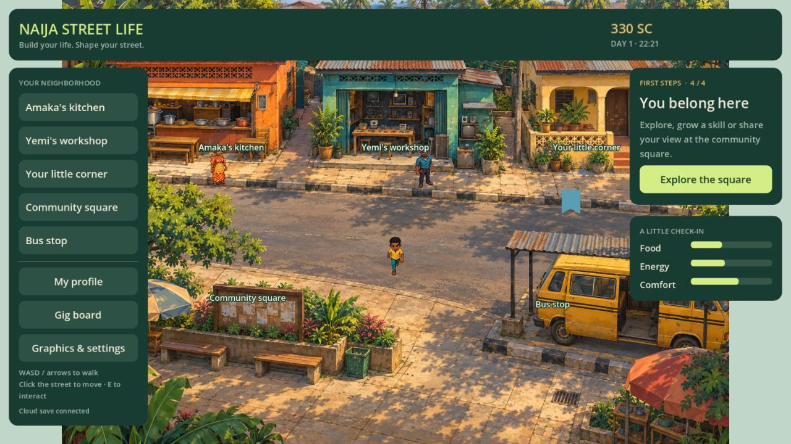
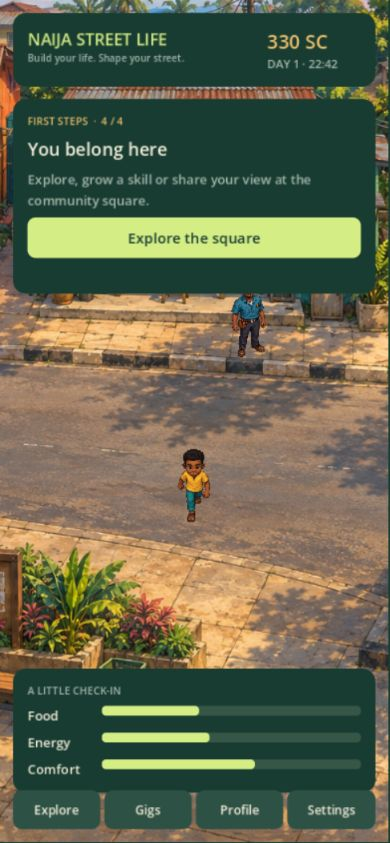

# Illustrated/cloud build checkpoint — 13 October 2026

This is a working first slice of the new visual direction and self-hosted save milestone, not the full live game. The root GitHub repository is prepared for Coolify. Actual installation on the owner's server/domain is a deployment step outside this authoring environment.

## Implemented

- Painted Nigerian street, animated directional protagonist, Amaka/Yemi sprites, venue travel and portrait camera following.
- Godot browser/native HTTP adapter sending intent/revision/idempotency keys. Local balances never upload. Cloud rewards remain server-owned; cached activities cannot complete locally.
- Server-backed starter activities/skills/fictional balance, profile, home accent, private drafts and private practice choice.
- Save access code creates sessions on another device; only code/token hashes live in the database. Initial managed email/password recovery and code rotation are not included.
- Persisted pending commands, safe retries and stale-revision refresh. Expired sessions can reconnect with a save code.
- PostgreSQL adapter and transactional versioned migration, row locking before receipt lookup, append-only ledger, API rate limits and one-origin static game delivery.
- Root multi-stage non-root Dockerfile and Compose stack with private PostgreSQL 17 volume, health checks and production SQLite refusal.
- Coolify/Cloudflare setup guide and CI for real PostgreSQL concurrency plus Docker build/start checks.

## Validation

28 Godot simulation checks pass, including no cloud-cache rewards. Actual-scene layout checks pass. TypeScript checks/build and four backend integration scenarios pass locally. Embedded PostgreSQL validates SQL/migration, retry/conflict/recovery/ledger/draft paths; a real multi-connection PostgreSQL CI service provides the stronger concurrency check. Docker is absent on this Windows host; local Docker execution is not claimed.

Browser interaction verified against the local development service: automatic cloud connection, welcome/profile save, Amaka greeting, server-timed practice, starter gig across immediate reload and balance 240→330. The development service uses disk SQLite for this browser test; PostgreSQL behavior is covered separately by the adapter integration scenario. Current game payload is 13.18 MiB plus the landing illustration; expanded WASM is about 36 MiB. Android debug APK is about 57.04 MiB, version 0.2, with Internet permission, and exports/signs successfully; deployed HTTPS, native input/rendering and phone performance remain to test.

## Visual evidence

All artwork was made with the built-in imagegen tool; files and complete generation prompts are documented in ART_DIRECTION.md. No Omins/old research assets or account credentials are embedded. The street is presently one painted background, with sprite actors and an editable home accent, rather than a full modular city or editable interior.

The initial repository workflow passed against real PostgreSQL 17, then built the Docker image and started it serving health and game HTML: https://github.com/deansheriff/Naija-GTA/actions/runs/38346746792. Local and cloud snapshots now use separate save slots; connecting a cloud character does not overwrite an existing local prototype save. New configured cloud connections skip the local name prompt; names remain editable through Profile.

## Limits and deployment

Compose deployment steps are in COOLIFY.md. A persistent volume is not a backup. Save access codes grant character access; lost-code recovery is not available. Rate limits are process-local and proxy peers can share them. Wider launch still needs measured phones/native networking, managed identity, retention, backup/restore and monitoring.

Shared marketplace, multiplayer, actual elections, Jev, licensed news, payments, escrow and airtime/data redemption are absent. StreetCoins are fictional. This checkpoint does not claim the final engine feasibility gate on physical low-end devices.
